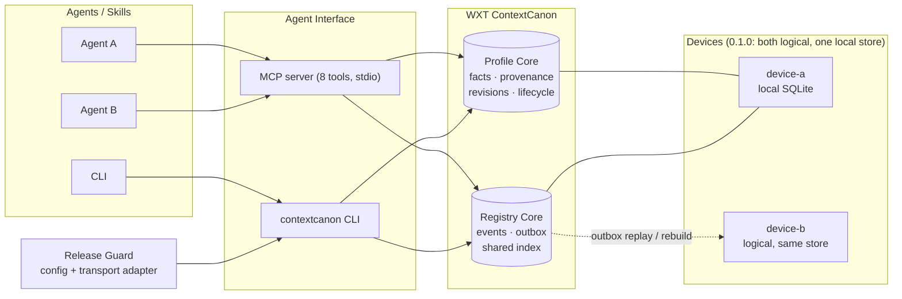

# WXT ContextCanon

> Canonical context and state for AI agents.

**WXT ContextCanon 0.1.0 — Public release.** Repository:
https://github.com/markingtang/wxt-contextcanon

You run several AI agents. Each one starts fresh, re-learns the same things about you, and
quietly disagrees with the others. WXT ContextCanon gives them **one shared, structured,
time-aware personal context** and **one append-only file-state ledger** — so "what is true
now" has exactly one answer, and "what did we believe before the correction?" is still
recoverable.

| | |
|---|---|
| Multi-agent — many agents, one machine | **shipped** |
| Shared personal context | **shipped** |
| Temporal facts, provenance, revisions, conflict handling | **shipped** |
| Registry ledger, offline outbox, rebuildable shared index | **shipped** |
| Runtime | **single machine**, SQLite, local-first |
| Runtime dependencies | **zero** — Python standard library only |
| Real cross-machine transport | **not shipped** |

**Real cross-machine transport is not shipped.** A second device is *simulated* in the same
local store to prove the ledger mechanics; nothing here talks over a network. Today's
runtime is single-machine. See [Current limitations](#current-limitations).

It is **not** an agent framework — it does not create, orchestrate or run agents. It is the
substrate your agents read from and write to.

---

## 30 seconds

You have several AI agents. They run in different tools, on different projects, maybe in
a container. Each one starts fresh every time and re-learns the same things about you —
your preferences, your constraints, what you already decided last week. Worse, they
disagree with each other, and when two of them touch the same files, nobody knows what
the current state actually is.

WXT ContextCanon is the missing shared layer:

- **Profile Core** — one structured, sourced, time-aware personal context. Facts have
  provenance, sensitivity, revisions, and validity windows. A correction supersedes; a
  contradiction is rejected; an expired fact stays auditable instead of vanishing.
- **Registry Core** — a file-state ledger. Append-only events per device, a local outbox
  so work continues offline, and a shared index that is a pure projection you can
  rebuild at any time.

Today all of this runs on **one machine** against SQLite. Multiple agents on that machine
is the solved case; a second physical machine is simulated locally, not connected over a
network. No cloud, no NAS, no paid service, no vector database, no LLM required.

---

## Why it exists

Plain text memory works — until it doesn't. The failure mode is never "I forgot a fact".
It is:

- two agents holding **different** versions of the same fact, both confident
- no record of **where** a fact came from or **when** it stopped being true
- a stretch of offline work elsewhere that silently clobbers what you had locally
- no way to answer "what did we believe *before* the correction?"
- file changes made by an agent with no declared intent and no trail

WXT ContextCanon targets exactly those. It does not try to be a smarter chatbot memory; it tries to
be the boring, correct substrate underneath.

---

## Who it is for

- People running **more than one** AI agent today, and who want those agents to agree.
- Developers designing toward multi-device workflows, who want the ledger semantics
  settled before the transport exists.
- Anyone who has outgrown a `MEMORY.md` file but does not want a hosted SaaS memory product.

Not for you if: you use a single assistant and a text file is fine.
That is a genuinely good setup, and this project says so in its own benchmark.

Not for you yet if: you need two real machines to synchronise today. That works in the
design, not in the shipped code.

---

## Architecture



Design rules that make this work across devices — **all five are implemented and tested
in 0.1.0; only the transport between real machines is missing**:

| Rule | What it buys you |
|---|---|
| Events are append-only | Nothing is silently rewritten |
| The shared index is a projection | Corrupt it, rebuild it |
| Every event has an id | Replay is idempotent |
| Work queues locally first | Offline is normal, not an error |
| A failed rebuild restores last-good | Degrade, never destroy |
| Mutation intent before writes | You know what an agent meant to touch |

---

## Three real scenarios

**1. Two agents, one truth.**
Agent A learns your editor changed to `zed`. Agent B still believes `vscode`. In WXT ContextCanon the
new value supersedes the old one; the old one stays as a revision with its provenance.
Both agents reading the profile get the same answer, and `profile_history` shows what
changed and when.

**2. Two devices, one of them offline.**
A second logical device queues file-state changes into a local outbox while it is
"offline". When it reconnects, the events replay into the ledger, duplicate deliveries are
skipped by event id, and a rebuild reconciles the shared index. No clobbering, no lost
work. *This is the mechanism you want for a real second machine — 0.1.0 runs the second
device inside one process, so the transport is still to be built.*

**3. "What did we believe in March?"**
Facts carry `valid_from` / `valid_until`. `profile_as_of` answers for any timestamp,
including inside a temporary or scheduled window. The shipped last-write-wins Markdown
baseline does not model validity windows at all.

---

## Quickstart (about 10 minutes, no Docker)

Requires Python 3.9+ and SQLite. **No third-party packages.**

```bash
git clone https://github.com/markingtang/wxt-contextcanon.git wxt-contextcanon
cd wxt-contextcanon

# macOS / Linux / Git Bash
./contextcanon demo seed --reset
./contextcanon profile get --subject demo:alex-chen --key tooling.editor

# Windows
contextcanon.cmd demo seed --reset
contextcanon.cmd profile get --subject demo:alex-chen --key tooling.editor

# Anywhere, no wrapper needed
PYTHONPATH=packages python -m contextcanon_cli demo seed --reset
```

Then walk the whole thing. The three invocations are equivalent — pick whichever fits your
shell (after `pip install -e .` the bare `contextcanon` is on your `PATH`):

```bash
./contextcanon profile list  --subject demo:alex-chen          # 20+ synthetic facts

# a temporal read: ask what was true ~30 days ago. The date is computed, so the
# example never drifts out of the demo's validity window as time passes.
PAST=$(python -c "import datetime as d;print((d.datetime.now(d.timezone.utc)-d.timedelta(days=30)).replace(microsecond=0).isoformat().replace('+00:00','Z'))")
./contextcanon profile as-of --subject demo:alex-chen --at "$PAST"

./contextcanon registry demo --reset                            # two devices, offline, converge
./contextcanon benchmark smoke                                  # 7-case subset, deterministic, no LLM judge
./contextcanon guard plan                                       # dry-run deployment guard
./contextcanon mcp                                              # start the MCP stdio server
```

Everything is written to `./data`. Delete it to start over. Nothing outside the
repository is read or written.

Prefer containers? `docker compose -f deploy/docker/docker-compose.yml up -d` exists, but
**the quickstart does not need Docker**.

### Add it to an MCP client

```json
{
  "mcpServers": {
    "wxt-contextcanon": {
      "command": "python",
      "args": ["-m", "mcp_server"],
      "env": { "PYTHONPATH": "/absolute/path/to/wxt-contextcanon/packages" },
      "cwd": "/absolute/path/to/wxt-contextcanon"
    }
  }
}
```

---

## MCP example

```jsonc
// read
{ "method": "tools/call", "params": { "name": "profile_get",
  "arguments": { "subject": "demo:alex-chen", "key": "timezone" } } }

// write (the previous value becomes a superseded revision)
{ "method": "tools/call", "params": { "name": "profile_upsert",
  "arguments": { "subject": "demo:alex-chen", "key": "tooling.editor",
                 "value": "zed", "source": "user-stated", "durability": "durable" } } }

// reject a contradiction instead of overwriting
{ "method": "tools/call", "params": { "name": "profile_upsert",
  "arguments": { "subject": "demo:alex-chen", "key": "timezone",
                 "value": "America/New_York", "on_conflict": "reject",
                 "source": "inferred", "confidence": 0.25 } } }

// what was true at time T
{ "method": "tools/call", "params": { "name": "profile_as_of",
  "arguments": { "subject": "demo:alex-chen", "timestamp": "<ISO timestamp of interest>" } } }
```

Eight tools: `profile_get`, `profile_search`, `profile_upsert`, `profile_as_of`,
`profile_history`, `profile_audit`, `registry_query`, `registry_event`.
Supersede and conflict handling are parameters of `profile_upsert`, not separate tools —
see [docs/MCP_TOOLS.md](docs/MCP_TOOLS.md).

---

## Registry example

```bash
# declare what you are about to touch, before touching it
contextcanon registry begin --task-id t-42 --intent "reorganise notes" --targets notes/a.md
contextcanon registry event  --kind file.upsert --object-key notes/a.md --checksum abc123
contextcanon registry end    --task-id t-42 --result ok --changed notes/a.md

contextcanon registry query  --object-key notes/a.md
# [{ "object_key": "notes/a.md", "device_id": "demo-device",
#    "state": { "status": "present", "checksum": "abc123" }, "version": 1 }]

# finished the work queued while offline
contextcanon registry recover      # drain outbox -> rebuild index -> converged
```

The shared index is derived state. `contextcanon registry rebuild` recomputes it from the event
log at any time, and if the rebuild fails it restores the last known-good index.

In 0.1.0 every device id lives in the same local database. The mechanics are real; the
network between machines is not.

---

## Privacy model

- **Local first.** Default storage is a SQLite file inside the repository. No network
  calls are made by Profile Core or Registry Core.
- **No telemetry, no phone-home, no account.**
- **Sensitivity is a field, not a convention.** Every fact carries one of
  `public | personal | sensitive | restricted`. Use it to decide what may be summarised
  or logged.
- **Deletion is not the default.** Expired, superseded and rejected facts are retained so
  history is auditable. If you need a fact gone, delete the SQLite rows directly — that
  is deliberate: silent data loss is worse than an explicit operation.
- **The shipped demo persona is fictional.** `demo:alex-chen` is synthetic data marked
  `DEMO / SYNTHETIC`. No real person, device, host, project or identifier appears anywhere
  in this repository.
- See [SECURITY.md](SECURITY.md) and [docs/concepts/privacy.md](docs/concepts/privacy.md).

---

## Why not just Markdown?

Because on the easy part, Markdown wins, and we are not going to pretend otherwise. Our
own benchmark ships with a Markdown baseline, and here is the honest scoreboard on 9
deterministic synthetic cases:

| | WXT ContextCanon | Markdown baseline |
|---|---|---|
| Simple recall | PASS | **PASS** |
| Write then read back | PASS | **PASS** |
| Two agents read one shared store | PASS | **PASS** |
| What was true at time T | PASS | FAIL |
| Revision chain of a fact | PASS | FAIL |
| Contradiction is rejected, truth kept | PASS | FAIL |
| Which facts came from an inference? | PASS | FAIL |
| Expired fact still auditable | PASS | FAIL |
| Offline work converges after rebuild | PASS | FAIL |

The shipped last-write-wins Markdown baseline has no model of time, conflict, provenance,
or two writers. That is the gap WXT ContextCanon fills. If your problem is "remember my favourite
editor", a text file is fine.

Run it yourself: `contextcanon benchmark run` (no LLM judge, deterministic, synthetic fixtures).
The table above is the **full suite, 9 cases: WXT ContextCanon 9/9, Markdown 3/9**.
`contextcanon benchmark smoke` runs a **7-case subset** of those same cases — WXT ContextCanon 7/7,
Markdown 3/7 — so the two numbers are not in conflict; the smoke run is a subset, not a
second opinion.

---

## Current limitations

Be aware of these before you build on it:

- **0.1.0 is single-machine at runtime.** Multi-agent is real. The second device in
  `contextcanon registry demo` is a logical device inside the same local database, used to prove
  the ledger mechanics. **Real cross-machine transport is not shipped.**
- **SQLite only.** The service layer is storage-agnostic but PostgreSQL is not wired up.
- **No server process.** There is no HTTP API in 0.1.0; MCP is stdio and everything else is
  the CLI. The Docker health endpoint is a placeholder.
- **No ingestion.** No email, calendar, health or finance connectors. No automatic chat
  import. Facts enter through the CLI or MCP.
- **No UI.** No dashboard, no web app, no mobile app.
- **No retrieval magic.** No vector search, no graph, no embeddings, no LLM. Facts are
  structured and indexed; search is substring-based.
- **Single user.** No multi-tenancy, no permission backend, no hosted version.
- **Benchmark is small.** 9 cases in the full suite, 7 in the `smoke` subset. It
  demonstrates the shape of the argument, not a research-grade evaluation.

---

## Roadmap (indicative, not committed)

1. Multi-device transport over the existing event log and outbox.
2. PostgreSQL backend behind the same service interface.
3. Conflict review workflow (a human resolves `rejected` candidates).
4. A read-only inspection UI over the audit trail.
5. Selective export / import of a subject, with sensitivity filtering.
6. Larger benchmark with community-contributed cases.

---

## Repository layout

```
packages/
  profile_core/         structured facts, provenance, revisions, lifecycle
  registry_core/        device identity, events, outbox, shared index
  mcp_server/           stdio MCP server, 8 tools, standard library only
  contextcanon_cli/     the `contextcanon` command line interface
  contextcanon_config/  configuration loader (defaults are all local)
deploy/
  docker/               optional container path
  local/                no-Docker instructions
  release-guard/        deployment guard + fake stack
benchmark/              synthetic cases, fixtures, runner, Markdown baseline
skills/contextcanon/    thin agent skill (when to recall / update / declare intent)
examples/               demo persona and example configs
docs/                   architecture, quickstart, concepts, audits
tools/                  secret scanner, isolation proof, clean-home acceptance
tests/                  the gates, including the brand consistency check
LICENSE  NOTICE  TRADEMARKS.md
```

---

## License

**Apache-2.0.** See [LICENSE](LICENSE) for the full text and [NOTICE](NOTICE) for
attribution. The repository has no third-party runtime dependencies (Python standard
library + SQLite only) and contains no vendored third-party source — see
[docs/THIRD_PARTY_NOTICES.md](docs/THIRD_PARTY_NOTICES.md) for the full audit.

Apache-2.0 covers the code only. It does not grant trademark rights and does not let anyone
present a fork as the official project. **WXT ContextCanon is maintained by Xiaotang
(王小堂)** — see [TRADEMARKS.md](TRADEMARKS.md) for the naming and attribution position.

---

## Development

```bash
python tests/run_all.py                       # 116 tests
python tools/scan_secrets.py                  # secret / private-identifier gate (working tree)
python tools/scan_secrets.py --history        # same gate, every git object on every ref
python tools/prove_isolation.py               # no path to any production system
python tools/accept_clean_home.py             # fresh-clone acceptance on a clean HOME
```

See [CONTRIBUTING.md](CONTRIBUTING.md).
