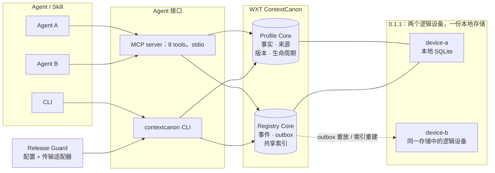

# WXT ContextCanon

[English](README.md) | 简体中文

> 为 AI Agent 提供统一的上下文与状态记录。

**WXT ContextCanon 0.1.1 — 公开版本。** 仓库：
https://github.com/markingtang/wxt-contextcanon

你使用多个 AI Agent，它们每次都重新了解你的偏好、约束和决定，有时还各自保留不同答案。
WXT ContextCanon 为它们提供**一份共享、结构化、带时间有效期的个人上下文**，以及
**一份只追加的文件状态账本**。被接受的事实声明有明确的版本和有效时间窗口。
项目记录声明，但不会核实声明是否真实。

| 能力 | 当前状态 |
|---|---|
| 多 Agent：同一台机器上的多个 Agent | **已实现** |
| 共享个人上下文 | **已实现** |
| 事实有效期、来源、修订、冲突处理 | **已实现** |
| Registry 事件账本、离线队列、可重建共享索引 | **已实现** |
| 运行环境 | **单机**、SQLite、本地优先 |
| 运行时依赖 | **零第三方包**，仅 Python 标准库 |
| 真实跨机器传输 | **尚未实现** |

**当前不支持真实跨设备同步。** 演示中的第二个设备是在同一份本地存储中模拟的逻辑设备，
用于验证账本机制，没有机器间的网络传输。详见[当前限制](#当前限制)。

项目不创建、编排或运行 Agent；它提供供 Agent 读写的基础数据层。

## 30 秒了解

不同工具或项目里的 Agent 经常重新学习同样的背景：你的偏好、限制、上周已做出的决定。
两个 Agent 操作同一批文件时，也需要知道文件当前的状态和变更意图。

- **Profile Core**：结构化的个人上下文，记录事实来源（provenance）、敏感度、修订和有效期。
  更正会保留旧版本，冲突可以拒绝，过期事实仍可审计。
- **Registry Core**：文件状态账本。按设备记录只追加事件，离线工作先进入 outbox，
  共享索引是可以重新计算的投影。

这些能力目前都运行在**同一台机器**的 SQLite 中。多个 Agent 可以共享数据；第二台物理机器
尚未接入。无需云服务、NAS、付费服务、向量数据库或大语言模型（LLM）。

## 为什么做这个项目

文本记忆简单有效，但有些问题需要更明确的记录：

- 两个 Agent 各持一份不同版本的事实，却都认为自己的答案正确。
- 不知道事实来自哪里，或者什么时候失效。
- 离线工作的变更回来后覆盖已有状态，缺少过程记录。
- 无法查询“更正之前我们记录的是什么”。
- Agent 修改文件前没有声明意图，事后也没有线索。

WXT ContextCanon 用版本、来源、时间窗口和事件账本处理这些问题，目标是提供可核查的基础层。

## 适合谁

- 已使用多个 AI Agent，希望它们在同机共享一份上下文的用户。
- 正在设计多设备流程，愿意先验证账本语义、以后再实现网络传输的开发者。
- 觉得 `MEMORY.md` 不够用，但希望继续使用本地存储的用户。

如果只用一个助手，文本文件已经够用，暂时无需引入本项目；我们的 benchmark 也明确展示了
简单场景下 Markdown 的有效性。如果现在就需要两台真实机器同步，本版本还不适合。

## 架构



以下规则已在本地运行时实现并测试；真实跨机器同步仍需进一步设计和测试。

| 规则 | 作用 |
|---|---|
| 事件只追加 | 不静默重写已有事件 |
| 共享索引是投影 | 索引损坏后可以重建 |
| 每个事件有 ID | 重放可以保持幂等 |
| 工作先进入本地队列 | 可以表达离线工作 |
| 重建失败恢复 last-good | 保留上一次可用索引 |
| 写入前声明变更意图 | 知道 Agent 准备操作哪些文件 |

## 三个具体场景

**1. 两个 Agent，共享一份记录。** Agent A 得知编辑器变为 `zed`，Agent B 仍记得 `vscode`。
新值可以取代旧值；旧值及来源保留为修订。同一 Profile 的读取者得到一致答案，
`profile_history` 可以查看变化。

**2. 两个逻辑设备，其中一个离线。** 第二个逻辑设备把变更放入 outbox，恢复后将事件重放进账本，
按 event ID 跳过重复投递，再重建索引。同 ID 但内容不同的事件会被拒绝。
0.1.1 在一个进程和本地存储内演示此机制，真实机器间传输尚待实现。

**3. “某个时间点有效的记录是什么？”** 事实带有 `valid_from` / `valid_until`，
`profile_as_of` 可以查询临时或计划时间窗口。随项目提供的 last-write-wins Markdown 基线
没有有效期模型。

## 5 分钟入门，无需 Docker

需要 Git 和带 SQLite 的 Python 3.9+。从源码运行无需安装第三方包。

```text
git clone https://github.com/markingtang/wxt-contextcanon.git
cd wxt-contextcanon
```

PowerShell：

```powershell
.\contextcanon.cmd demo seed --reset
.\contextcanon.cmd profile get --key tooling.editor
.\contextcanon.cmd profile as-of --days-ago 30
```

CMD 使用 `contextcanon.cmd`；Linux/macOS/Git Bash 使用 `./contextcanon`。
完整的四种 Shell 命令、预期结果、安装和使用说明见[中文快速教程](docs/quickstart/local.zh-CN.md)。

默认数据放在当前工作目录的 `data/` 中，配置和环境变量可以改变路径。请先用全新 clone 和虚构数据。
不要对存有真实工作数据的数据库执行演示重置。

真实客户端接入见[MCP 配置与验证](docs/MCP_TOOLS.zh-CN.md#客户端配置)。服务器使用旧版初始化协议；
官方 Inspector 2.9.0 和 SDK 2.3.1 已验证，强制只用现代 MCP 协议的客户端不受支持。

可选 Docker 是一次性 CLI 环境：
`docker compose -f deploy/docker/docker-compose.yml run --rm contextcanon-api`。
它没有常驻 API，Docker 实跑不属于已验证的 Quickstart 范围。

## MCP 示例

```jsonc
// 读取
{ "method": "tools/call", "params": { "name": "profile_get",
  "arguments": { "subject": "demo:alex-chen", "key": "timezone" } } }

// 写入；旧值成为 superseded 修订
{ "method": "tools/call", "params": { "name": "profile_upsert",
  "arguments": { "subject": "demo:alex-chen", "key": "tooling.editor",
                 "value": "zed", "source": "user-stated", "durability": "durable" } } }

// 拒绝冲突，保留现有值
{ "method": "tools/call", "params": { "name": "profile_upsert",
  "arguments": { "subject": "demo:alex-chen", "key": "timezone",
                 "value": "America/New_York", "on_conflict": "reject",
                 "source": "inferred", "confidence": 0.25 } } }

// 查询指定有效时间；替换为实际 ISO 时间戳
{ "method": "tools/call", "params": { "name": "profile_as_of",
  "arguments": { "subject": "demo:alex-chen", "timestamp": "<ISO timestamp of interest>" } } }
```

8 个工具：`profile_get`、`profile_search`、`profile_upsert`、`profile_as_of`、
`profile_history`、`profile_audit`、`registry_query`、`registry_event`。
取代和冲突处理是 `profile_upsert` 的参数，详见[工具指南](docs/MCP_TOOLS.zh-CN.md)。

## Registry 示例

下列命令从仓库根目录在 Bash 中运行。

```bash
# 操作文件前声明意图
./contextcanon registry begin --task-id t-42 --intent "reorganise notes" --targets notes/a.md
./contextcanon registry event  --kind file.upsert --object-key notes/a.md --checksum abc123
./contextcanon registry end    --task-id t-42 --result ok --changed notes/a.md

./contextcanon registry query  --object-key notes/a.md
# [{ "object_key": "notes/a.md", "device_id": "demo-device",
#    "state": { "status": "present", "checksum": "abc123" }, "version": 1 }]

./contextcanon registry recover
```

共享索引是派生状态；`./contextcanon registry rebuild` 从事件日志重新计算。
重建失败会恢复上一次可用的索引。0.1.1 的所有 device ID 都位于同一份本地数据库，尚无机器间网络。

## 隐私模型

- **本地优先**：默认 SQLite 文件在工作目录内。Profile Core 和 Registry Core 不发起网络调用。
- **无遥测、回传、账号要求**。
- **敏感度只是标签**：`public | personal | sensitive | restricted` 可供调用方判断如何展示和记录；
  所有接入的 Agent 都能读取所有敏感度等级，标签不提供访问控制。
- **保留历史**：过期、被取代和被拒绝的事实仍可审计。没有完整擦除 API，审计和备份可能保留旧值。
- **演示人物是虚构的**：`demo:alex-chen` 为 `DEMO / SYNTHETIC` 数据；公开仓库不应包含真实私人
  人物、设备、主机、项目或标识符。
- 详见[中文安全说明](SECURITY.zh-CN.md)和[隐私概念（英文）](docs/concepts/privacy.md)。

## 为什么不直接用 Markdown

简单场景中 Markdown 已经很好。benchmark 包含一个简单的 last-write-wins Markdown 基线，
使用 9 个确定性的虚构案例，没有 LLM 评分者。

| 案例 | WXT ContextCanon | Markdown 基线 |
|---|---|---|
| 简单回忆 | PASS | PASS |
| 写入后读回 | PASS | PASS |
| 两个 Agent 读取同一存储 | PASS | PASS |
| 指定时间有效的事实 | PASS | FAIL |
| 事实修订链 | PASS | FAIL |
| 拒绝冲突并保留原值 | PASS | FAIL |
| 查询推断来源的事实 | PASS | FAIL |
| 过期事实仍可审计 | PASS | FAIL |
| 离线队列经重建后收敛 | PASS | FAIL |

随项目提供的基线没有时间、冲突、来源或多写入者模型；这正是这里比较的能力差异。
它不代表所有 Markdown 工作流都只能做到这些。

自行运行 `./contextcanon benchmark run`：full 为 **9 个案例，ContextCanon 9/9，Markdown 3/9**。
`./contextcanon benchmark smoke` 是其中 **7 个案例的子集，ContextCanon 7/7，Markdown 3/7**。
这不是大型研究评测，也没有测试模型的推理质量。

## 当前限制

- **0.1.1 单机运行**：支持同机多 Agent；Registry 第二个设备只是本地逻辑设备，没有真实跨机器传输。
- **只有 SQLite**：事务和 SQL 依赖 SQLite，PostgreSQL 需要新实现。
- **没有 HTTP API**：MCP 使用 stdio，其余通过 CLI；Docker 是一次性命令容器，没有健康检查接口。
- **没有自动导入**：不连接邮件、日历、健康或财务平台，不自动导入 ChatGPT 等聊天记录；事实通过 CLI/MCP 写入。
- **没有图形界面**：没有 Dashboard、网页应用或手机应用。
- **没有向量检索或 LLM**：结构化索引，搜索按子串匹配；没有图数据库、embedding 或模型调用。
- **单用户**：没有多租户、权限后端或托管版本。
- **benchmark 规模小**：full 9 个、smoke 7 个，用于演示能力边界。

## 后续方向，尚无交付承诺

1. 基于现有事件日志和 outbox 的多设备传输。
2. 服务接口后面的 PostgreSQL 存储。
3. 人工处理 `rejected` 候选的冲突审核流程。
4. 只读审计查看界面。
5. 带敏感度过滤的 subject 导入/导出。
6. 社区贡献的更多 benchmark 案例。

## 仓库结构

```text
packages/
  profile_core/         事实、来源、修订、生命周期
  registry_core/        设备标识、事件、outbox、共享索引
  mcp_server/           stdio MCP server，8 个工具
  contextcanon_cli/     contextcanon 命令行
  contextcanon_config/  配置加载，默认本地路径
deploy/
  docker/              可选容器
  local/               无 Docker 使用说明
  release-guard/       发布守卫和虚构测试栈
benchmark/             虚构案例、fixtures、runner、Markdown 基线
skills/contextcanon/   轻量 Agent Skill
examples/              虚构人物和示例配置
docs/                  架构、入门、概念、安全检查
tools/                 扫描、隔离检查、clean HOME 验收
tests/                 自动测试
LICENSE  NOTICE  TRADEMARKS.md
```

## 许可

**Apache-2.0**。官方法律文本见 [LICENSE](LICENSE)，署名信息见 [NOTICE](NOTICE)。
运行时只有 Python 标准库和 SQLite，无第三方运行包或随仓库分发的第三方源码，
见[第三方声明（英文）](docs/THIRD_PARTY_NOTICES.md)。

本段中文仅为非权威解释，正式许可条件以原始 LICENSE 为准。Apache-2.0 不授予商标权，
也不允许把分支宣称为官方项目。维护者为 Xiaotang（王小堂），名称与署名规则见
[TRADEMARKS.md](TRADEMARKS.md)。

## 开发与验证

```bash
python tests/run_all.py
python tools/scan_secrets.py
python tools/scan_secrets.py --history
python tools/prove_isolation.py
mkdir synthetic-watch
python tools/accept_clean_home.py --watch synthetic-watch
```

隔离检查只是静态配置和指定目录元数据检查，不是沙箱。
贡献步骤见[中文贡献指南](CONTRIBUTING.zh-CN.md)。本页 Bash 示例从仓库根目录运行；
PowerShell 使用 `.\contextcanon.cmd`，CMD 使用 `contextcanon.cmd`。
中文文档入口见[文档导航](docs/README.zh-CN.md)。
